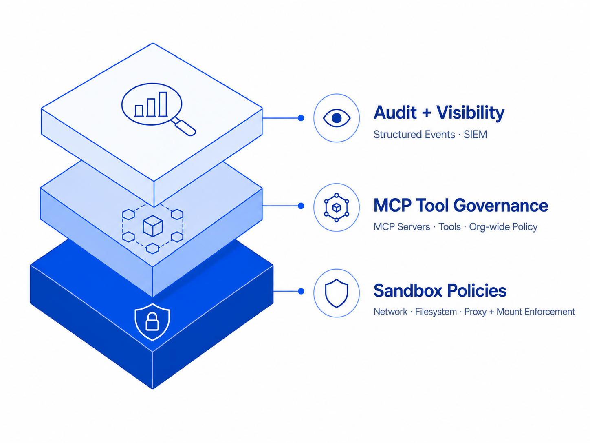

# Docker AI Governance Trust Layer

This repository accompanies the article **The Trust Layer: Securing Agentic AI with Docker AI Governance**.

In this project, **trust layer** is shorthand for the infrastructure between what an AI agent wants to do and what an organization actually allows it to do. It is an engineering framing used here, not a separate Docker product or architecture.

Docker AI Governance brings together three areas:

- **Sandbox Policies** — control the network and filesystem boundaries around Docker Sandboxes.
- **MCP Tool Governance** — control governed MCP activity through organization policy.
- **Audit + Visibility** — provide structured records of governance activity for investigation and existing security workflows.



*Figure 1: The three layers of Docker AI Governance — Sandbox Policies, MCP Tool Governance, and Audit + Visibility.*

## Sandbox Policies

A model instruction is not a security boundary.

Docker Sandboxes can enforce network and filesystem policy outside the agent itself. Developers can check the effective network boundary before an agent starts working:

```bash
$ sbx policy check network api.anthropic.com
Allowed: api.anthropic.com

$ sbx policy check network blocked.example.com
Denied: blocked.example.com
```

The result comes from the active policy rather than from an instruction the agent is expected to follow.

## MCP Tool Governance

MCP (Model Context Protocol) gives agents access to external tools and services. Docker AI Governance applies organization policy to MCP activity handled through Docker's MCP Gateway.

MCP organization policies use Cedar. For example:

```cedar
permit (principal, action == MCP::Action::"invokeTool", resource)
when {
  resource in MCP::Server::"example" &&
  resource.readOnly == true
};
```

See [`mcp/read-only-tools.cedar`](mcp/read-only-tools.cedar).

MCP policy applies to activity handled through Docker's MCP Gateway. Direct connections from a sandbox to a remote MCP server remain subject to sandbox network policy.

## Audit + Visibility

Security teams also need evidence of how governance policy was applied.

Docker AI Governance records sandbox policy decisions and sandbox session events as structured audit records. These records can support investigation and SIEM workflows.

## Docker Hardened Images

Docker Hardened Images address a related but separate supply-chain concern.

Docker Hardened Images provide **minimal, secure, and production-ready container images, Helm charts, and system packages maintained by Docker**.

For container images, Docker Hardened Images include signed SBOMs, VEX information, cryptographic signatures, and SLSA Build Level 3 provenance. Relevant DHI offerings also provide FIPS-enabled and STIG-ready variants.

AI Governance controls the authority an agent has while it works; Docker Hardened Images help establish trust in the software artifacts used by those workflows.

## The Engineering Idea

**A model decision is not automatically an authorized action.**

The model can decide how it wants to complete a task. Infrastructure determines which actions are actually permitted.

That distinction is the trust-layer framing used throughout this project.

## Official References

- Docker AI Governance: https://www.docker.com/products/ai-governance/
- Governance documentation: https://docs.docker.com/ai/sandboxes/governance/
- Sandbox access controls: https://docs.docker.com/ai/sandboxes/governance/access-controls/
- MCP governance: https://docs.docker.com/ai/sandboxes/governance/access-controls/mcp/
- MCP policy reference: https://docs.docker.com/ai/sandboxes/governance/reference/mcp-policy/
- Audit Logs: https://docs.docker.com/ai/sandboxes/governance/audit/
- SIEM integration: https://docs.docker.com/ai/sandboxes/governance/audit/siem/
- Docker Hardened Images: https://docs.docker.com/dhi/
