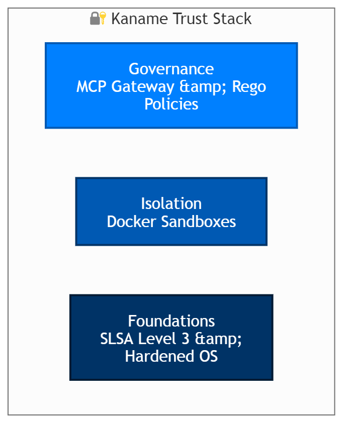

# [Kaname] Trust Stack: Reference Implementation

This repository provides a technical blueprint for securing Agentic AI workflows using the **Trust Stack** architecture. It serves as a companion to the official Docker Captain series.

### The Architecture

The Trust Stack is a hierarchical security model that moves from foundational system integrity to high-level policy governance.

### 1. Governance (Top Layer)
* **Component:** MCP Gateway & Rego Policies
* **Purpose:** Fine-grained control over AI actions.
* **Location:** `/governance`

### 2. Isolation (Middle Layer)
* **Component:** Docker Sandboxes
* **Purpose:** Hardened runtime isolation using micro-VM technology to prevent container escapes.
* **Location:** `/isolation`

### 3. Foundations (Bottom Layer)
* **Component:** Hardened OS & Verified Supply Chain
* **Purpose:** Ensuring the 'Ground' the AI stands on is minimal (distroless/slim) and SLSA Level 3 compliant.
* **Location:** `/foundation`

---

## 🚀 How to Use
This is a reference architecture. Developers can clone this repo to:
1. **Test Policies:** Use the Rego files to define what their agents can/cannot do.
2. **Harden Environments:** Use the Sandbox configurations to wrap existing agents.
3. **Audit Integrity:** Use the Dockerfiles as a baseline for secure image builds.

---
*Note: This repository is currently in Private Preview aligned with the [Kaname] Early Access Program.*
